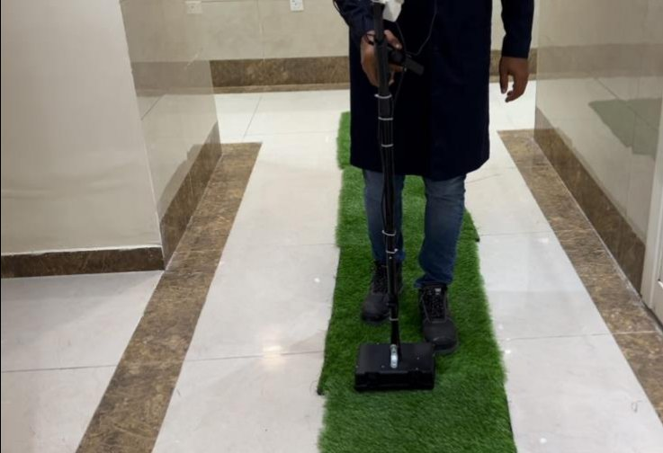
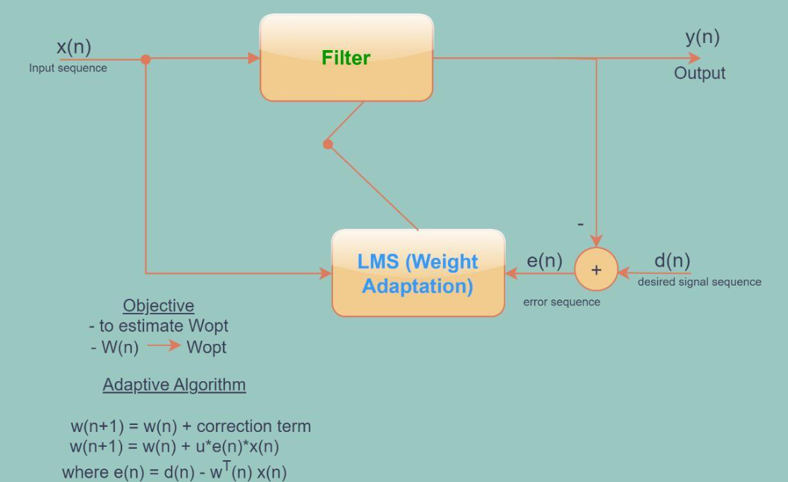
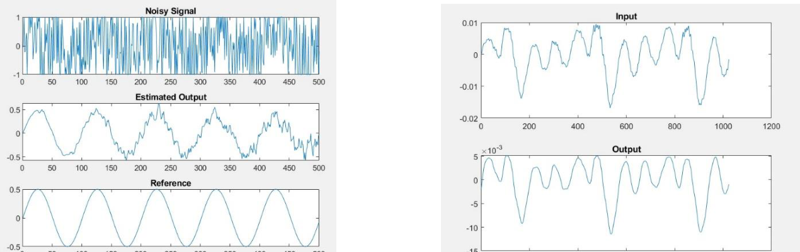

# Underground Cable Fault Locator

A low-cost tool that helps engineers find the exact spot of a fault in an
underground power cable. It removes background noise from the sound of the
fault and uses a small neural network to confirm when that sound is present.



## Why

To pinpoint a cable fault, engineers send high-voltage impulses into the cable.
The fault arcs and makes a thumping sound at ground level, and the engineer
listens for it while walking along the cable route. Traffic, people and
machinery can hide this sound or imitate it. Engineers often wait for night,
when it is quiet. Commercial locators that solve this are expensive.

## How it works

1. **Noise cancelling (STM32F401RE).** Two INMP441 microphones feed an
   adaptive filter. The primary microphone faces the ground and hears the thump
   plus noise. The reference microphone hears only the noise. A normalized
   least mean squares (NLMS) filter removes the part of the primary signal that
   matches the reference. The operator hears the result on headphones.
2. **Thump detection (Raspberry Pi).** A classifier trained in Edge Impulse
   (MFCC features and a 1D CNN, two classes: Noise and Thumping) shows on
   screen when a thump is detected.



## Results

From the prototype tests in the [technical report](docs/UGC_Fault_Locator_Technical_Report.pdf):

| Test | Result |
|---|---|
| Classifier accuracy on the Edge Impulse test set | 96.07% (Noise 96.0%, Thumping 96.2%) |
| Classifier F1 score | 0.97 Noise, 0.96 Thumping |
| Prototype search for a hidden thump source | Detected at the source with 86% confidence |
| MATLAB NLMS simulation | White noise removed from a sine wave; environmental noise reduced in real time |
| Component cost | 1,159 AED without the Raspberry Pi board (target: under 5,000 AED) |



## Hardware

- Nucleo-F401RE board
- 2 x INMP441 I2S MEMS microphone
- Digilent Pmod I2S2 audio module and 3.5 mm headphones
- Raspberry Pi with screen, and a USB audio adapter with an input (TODO: Pi model)
- 3D-printed enclosure on a pole, 9 V battery

Full parts list, pin table and wiring: [hardware/README.md](hardware/README.md).

## Software

| Part | Requirements |
|---|---|
| Firmware | STM32CubeIDE, STM32CubeF4 HAL |
| Simulation | MATLAB (no toolboxes needed) |
| Classifier | Raspberry Pi OS (64-bit), Python 3, packages in `classifier/requirements.txt`, an Edge Impulse account to train and export the model |

## Usage

### Firmware

Set up the STM32CubeIDE project as described in
[firmware/stm32f401re-nlms/README.md](firmware/stm32f401re-nlms/README.md),
then build and flash. The filter can be tested on a PC without hardware:

```bash
cd firmware/stm32f401re-nlms/test
cc -std=c99 -O2 -I../Core/Inc test_nlms.c ../Core/Src/nlms.c -lm -o test_nlms
./test_nlms
```

### Simulation

Open `simulation/nlms_simulation.m` in MATLAB and run it. To test your own
recordings, put `primary.wav` and `reference.wav` next to the script.

### Classifier

On the Raspberry Pi:

```bash
sudo apt install portaudio19-dev
cd classifier
pip install -r requirements.txt
python detect_thump.py --list-devices
python detect_thump.py --model model.eim --device 1
```

Export the model from Edge Impulse as "Linux (AARCH64)" to get `model.eim`.

## Project structure

```
classifier/   Raspberry Pi thump detection script
docs/         Technical report and figures
firmware/     STM32F401RE NLMS noise canceller and its PC test
hardware/     Parts list, pin table and wiring
simulation/   MATLAB NLMS simulation
```

## Limitations

- The INMP441 has low sensitivity, so the enclosure must be very close to the
  ground above the fault.
- Some noise still reaches the headphones after filtering.
- Few recordings of real cable thumps exist. The classifier was trained on a
  small data set with augmentation, and the prototype was tested indoors with a
  recorded thump, not on a live faulted cable.
- The filter parameters cannot be changed from the screen.

## Team

Electrical engineering capstone project (2023) by Fanuel Petros (team lead),
Tomas Yemane, Abduselam Ahmed, Micheale Habte and Abdulla Abdelrahim.

## License

[MIT](LICENSE)
