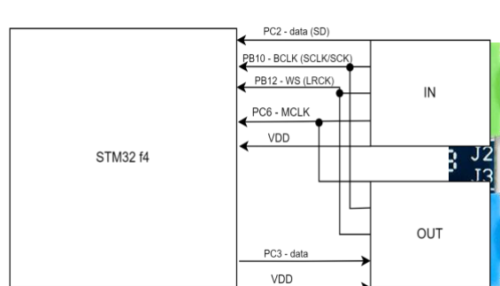
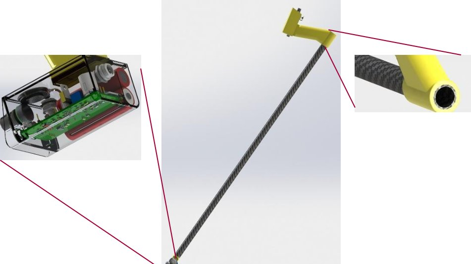
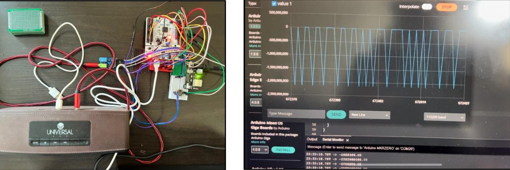

# Hardware

## Parts list

| Part | Qty | Cost (AED) | Role |
|---|---|---|---|
| Nucleo-F401RE (STM32F401RE, Cortex-M4F, 84 MHz) | 1 | 71 | Runs the NLMS noise canceller |
| INMP441 I2S MEMS microphone | 2 | 60 | Primary (ground) and reference (ambient) inputs |
| Digilent Pmod I2S2 (CS4344 DAC, CS5343 ADC) | 1 | 188 | DAC output to the 3.5 mm headphone jack |
| 100 kΩ resistor | 2 | 20 | Pull-down on each microphone SD pin |
| 100 nF capacitor | 2 | 10 | Supply decoupling at each microphone |
| Headphones, 3.5 mm | 1 | 120 | Operator listens to the cleaned signal |
| Raspberry Pi with screen | 1 | 200 (screen) | Runs the thump classifier and shows the result |
| 3D-printed enclosure and pole | 1 | 300 | Holds the electronics close to the ground |
| 9 V battery | 2 | 40 | Portable power |
| Miscellaneous (wires, connectors) | | 150 | |
| **Total** | | **1,159** | Raspberry Pi board not included |

To run `classifier/detect_thump.py` on the Pi you also need a USB audio
adapter with an input, so the STM32 audio output can reach the Pi.

## Wiring

| Signal | Nucleo pin | Connects to |
|---|---|---|
| I2S2_CK (bit clock) | PB10 | SCK on both INMP441, Pmod I2S2 pin 3 (D/A SCLK) |
| I2S2_WS (word select) | PB12 | WS on both INMP441, Pmod I2S2 pin 2 (D/A LRCK) |
| I2S2_MCK (master clock) | PC6 | Pmod I2S2 pin 1 (D/A MCLK) |
| I2S2_SD (data out) | PC3 | Pmod I2S2 pin 4 (D/A SDIN) |
| I2S2ext_SD (data in) | PC2 | SD on both INMP441 |
| 3V3 | CN6 3V3 | INMP441 VDD, Pmod I2S2 pin 6 (VCC) |
| GND | CN6 GND | INMP441 GND, Pmod I2S2 pin 5 (GND) |

| Microphone | L/R pin | I2S slot | Placement |
|---|---|---|---|
| Primary | GND | Left | Bottom of the enclosure, facing the ground |
| Reference | 3V3 | Right | Facing away from the ground |

- Fit a 100 nF capacitor between VDD and GND at each microphone.
- Fit a 100 kΩ pull-down from each microphone SD pin to GND.
- Plug the headphones into the Pmod I2S2 line-out jack (top row).
- Power the Nucleo from a 9 V battery on VIN (7 V to 12 V input). Check the
  power jumper settings for external supply in ST user manual UM1724.

## Prototype

